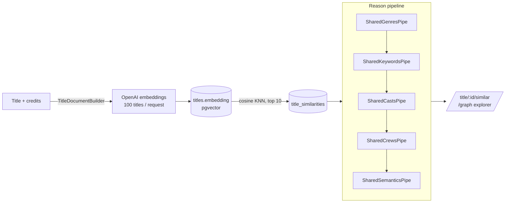
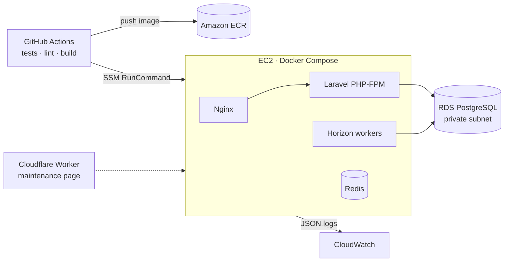

<h1 align="center">Chill</h1>

<p align="center">
  <strong>A movie &amp; TV discovery app that explains <em>why</em> two titles are alike.</strong><br>
  Explainable similarity graph · Hybrid + semantic search · Personal watchlists · Regional streaming availability
</p>

<p align="center">
  <a href="https://chill.harisw.com"><strong>🎬 Live demo → chill.harisw.com</strong></a>
</p>

<p align="center">
  <a href="https://github.com/harisw/tmdb-app/actions/workflows/deploy.yml"></a>
  
  
  
  
  
  
</p>

---

## At a glance

Chill is a full-stack app built and run by one developer. It pulls the movie/TV catalogue from TMDB on a schedule and adds three things TMDB, Letterboxd and JustWatch don't offer together:

| | |
|---|---|
| **Explainable recommendations** | Every "similar title" carries ranked, readable reasons (shared cast, crew, genres, keywords, themes). You can browse them as a force-directed graph. |
| **Search that understands intent** | Full-text, fuzzy and vector search fused into one ranking, with LLM-assisted query expansion (HyDE) behind a feature flag. Scored against an 86-query golden set. |
| **A personal taste layer** | Likes, watchlist, watched, ratings and "My List", plus streaming availability for the user's country. |

**What it shows about the engineering:**

- **AI/LLM engineering in production:** embeddings, pgvector KNN, rank fusion, HyDE, a multi-provider LLM gateway with failover, and Langfuse tracing. Search changes are judged by an offline evaluation (Recall@10, MRR), not by eye.
- **Backend architecture:** queue-driven ingestion and enrichment pipelines, typed DTOs at the API boundary, an `Illuminate\Pipeline` reason engine, and global query scopes.
- **Testing:** about 380 PHPUnit tests run in CI against real PostgreSQL + pgvector (no SQLite stand-in).
- **Cloud & DevOps:** Docker multi-stage builds, GitHub Actions → ECR → EC2 via SSM (no SSH), Terraform-managed AWS + Cloudflare, structured JSON logs in CloudWatch, and cost controls like scheduled start/stop of AWS resources.

<!-- Add a screenshot or GIF of the graph explorer here, e.g. docs/images/graph.gif -->

---

## Engineering highlights

### 1. Explainable similarity knowledge graph



- Similarity is **precomputed, never queried live**. An hourly batch job materializes neighbours for new titles and refreshes ones older than a week, so older titles pick up newer neighbours over time.
- Each title pair goes through a `ReasonContext` in a Laravel `Pipeline` of single-purpose pipes. The output is ranked, human-readable reasons instead of a bare score.
- The graph explorer ([`/graph`](https://chill.harisw.com/graph)) is a d3-force layout with lazy neighbour loading. It is backed by a cached "constellation" service that limits node count to keep rendering fast.
- The whole subsystem is gated by a Laravel Pennant flag, so it can be turned off without a deploy.

### 2. Hybrid search with measured quality

- `HybridSearchService` combines **PostgreSQL full-text** (`tsvector` / `ts_rank`), **trigram** similarity and **semantic** (pgvector) results. The fusion method is configurable: Reciprocal Rank Fusion, min-max or z-score normalisation.
- **HyDE** (Hypothetical Document Embeddings) sits behind a feature flag. An LLM writes a hypothetical catalogue entry for the query; that entry is embedded, and the model's title guess is also run through full-text search. HyDE is skipped for short queries and for queries that already match a title closely, which keeps latency and cost down.
- `php artisan search:evaluate {fts|semantic|hybrid|hyde}` scores each mode against a **golden set of 86 queries** in six categories (exact, typo, descriptive, people, multilingual, Indonesian), reporting **Recall@10 and MRR** per category.

### 3. Resilient LLM gateway with observability

- `LlmGateway` fails over across OpenAI-compatible providers (OpenAI → Groq) in a configured order. A provider that returns 429 or 5xx is put on cooldown for a while.
- Every call fires an `LlmOperationCompleted` event. A queued listener exports it to **Langfuse** over OTLP: one root span per operation and one generation per attempt, so retries and failovers show up in traces.

### 4. Ingestion and enrichment pipeline

- Scheduled jobs walk TMDB's trending, popular and upcoming feeds. Each one keeps paging until it has inserted *N new* titles, so it goes deeper as the catalogue fills.
- Credits, watch providers and embeddings are backfilled by jobs on dedicated queues (`enrichment`, `embeddings`), with one Horizon supervisor per queue in production.
- Incoming payloads are parsed into typed DTOs (`spatie/laravel-data`) that map TMDB field names to the domain model at the boundary.
- Streaming providers from three sources (TMDB, Watchmode, Streaming Availability) are merged into one canonical record per service using an alias table, so duplicate names never fork the data.

### 5. Infrastructure & operations



- **CI/CD:** each PR runs PHPUnit against a pgvector Postgres service container, plus Prettier and ESLint checks and a Vite build. Merges to `master` build and push the image to ECR and deploy through **SSM Session Manager**, so the instance has no inbound SSH port.
- **Terraform** (`infra/`) manages:
  - an EventBridge Scheduler and Lambdas that start and stop AWS resources outside active hours to cut cost
  - scheduled database exports to S3 with lifecycle rules, plus a CloudWatch alarm and SNS alert if an export goes missing
  - a Cloudflare Worker that serves a maintenance page while the stack is down
- **Observability:** JSON logs to stderr, shipped to CloudWatch by Docker's `awslogs` driver, with a `request_id` on every line and job metadata on queued work. Laravel Pulse covers app health, and Langfuse covers LLM traces.

---

## Tech stack

| Layer | Technology |
|---|---|
| **Backend** | Laravel 13, PHP 8.4, spatie/laravel-data, Laravel Pennant (feature flags), Socialite (Google OAuth) |
| **Frontend** | Vue 3, Inertia.js v2, Pinia, Tailwind CSS v4, daisyUI 5, Reka UI, d3-force, Vite 6 |
| **Data** | PostgreSQL 17 + pgvector, `tsvector` full-text search, `pg_trgm` |
| **AI / ML** | OpenAI embeddings, OpenAI/Groq LLMs via a failover gateway, Langfuse tracing |
| **Queues** | Redis + Laravel Horizon (production), database driver (local) |
| **Infra** | Docker, Nginx, AWS (EC2, RDS, ECR, S3, Lambda, EventBridge, CloudWatch, SNS, SSM), Cloudflare Workers, Terraform |
| **Quality** | PHPUnit (about 380 tests), Laravel Pint, ESLint, Prettier, Husky + lint-staged, GitHub Actions |

---

## Features

- **Browse:** trending, popular and upcoming, plus faceted browsing by genre, tag, streaming provider and language. A global movie/TV toggle applies everywhere.
- **Search:** single-type and cross-type search with typo tolerance and multilingual queries.
- **Title pages:** cast and crew, genres, keywords, ratings, and where to watch in your country.
- **Similar titles and graph explorer:** ranked reasons for each recommendation and an interactive force-directed graph.
- **Accounts:** email/password with verification, or Google sign-in. Like, watchlist, watched, rating and "My List". Avatar presets and country preference.
- **Admin:** feature-flag dashboard (`/admin/feature-flags`) behind an `admin` gate.

---

## Architecture notes

- **Inertia SPA, no public JSON API.** Every page, including the graph endpoints, is served from `routes/web.php` as Inertia props, so the app shares one session and auth model.
- **One `titles` table** for movies and TV, discriminated by `type`. Genres, keywords, companies, providers and people are many-to-many.
- **Global scopes do viewer-level filtering.** `TitleTypeScope` applies the movie/TV toggle, which a client-side router hook appends to every visit. `AvoidedKeywordScope` hides titles carrying the user's avoided keywords. Jobs and commands opt out explicitly.

For the full tour, see [`CLAUDE.md`](CLAUDE.md).

---

## Getting started

**Prerequisites:** PHP 8.4, Composer, Node 22+, Docker (for PostgreSQL + pgvector), plus a TMDB API key. An OpenAI key is optional; without it, similarity and semantic search stay inactive.

```bash
git clone git@github.com:harisw/tmdb-app.git && cd tmdb-app
cp .env.example .env            # fill in TMDB_API_KEY, OPENAI_API_KEY, DB_*
composer install && npm install
php artisan key:generate

docker-compose up -d            # PostgreSQL (pgvector) + Redis
php artisan migrate --seed

composer run dev                # app server + queue + logs + Vite
```

`composer run dev` only processes the default queue. To run ingestion and the similarity pipeline, start the other workers as well:

```bash
php artisan horizon
# or
php artisan queue:work --queue=embeddings,enrichment
```

To run the full stack in containers instead (app, Nginx and Postgres on `:8000`):

```bash
docker-compose -f docker-compose.local.yml up
```

---

## Testing

The suite needs a real PostgreSQL database (`tmdb_test`), because search and similarity rely on `tsvector` and pgvector operators. Setup steps are in [`docs/testing.md`](docs/testing.md).

```bash
composer run test                              # full suite
php artisan test --compact --filter=testName   # a single test
php artisan search:evaluate hybrid             # search quality vs. golden set
npm run lint && npm run format:check           # frontend checks
```

---

## Documentation

| Doc | Contents |
|---|---|
| [`docs/deployment.md`](docs/deployment.md) | AWS setup, security groups, ECR, SSM-based deploys |
| [`docs/testing.md`](docs/testing.md) | Test database setup |
| [`docs/troubleshooting.md`](docs/troubleshooting.md) | Common local issues |
| [`docs/troubleshooting-aws.md`](docs/troubleshooting-aws.md) | Production / AWS issues |

---

## Attribution


This product uses the TMDB API but is not endorsed or certified by TMDB. Streaming availability data is provided by JustWatch.

---

<p align="center">
  Built by <a href="https://github.com/harisw">Hari Setiawan</a>. Questions or opportunities? Open an issue or reach out on GitHub.
</p>
