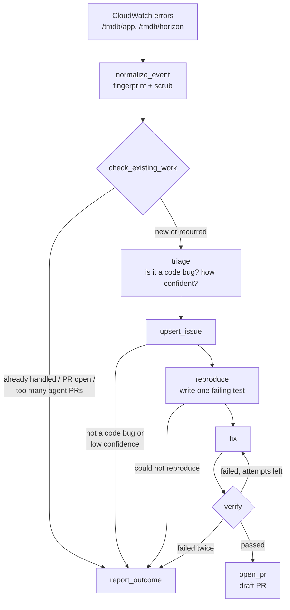

# Triage agent

Turns production errors into GitHub issues and, when it can, a **verified draft fix PR**.

It reads error logs from CloudWatch, groups identical errors, files one issue per error group, then asks Claude to (1) write a test that reproduces the error and (2) fix the code until that test passes. The PR is opened only if the fix passes the full test suite, Pint and Larastan in an isolated Docker sandbox. A human always reviews and merges.

Built with [LangGraph](https://langchain-ai.github.io/langgraph/) (the workflow) and the [Claude Agent SDK](https://docs.claude.com/en/api/agent-sdk/overview) (the reproduce and fix sessions).

## How it works



1. **Collect.** A CloudWatch Logs Insights query groups the last 26 hours of `ERROR`-level logs by exception class, origin, message and job. Database connection failures (`SQLSTATE[08…]`) are skipped, since they are infrastructure problems, not code bugs.
2. **Fingerprint.** Each error gets a 16-character fingerprint built from the exception class and the first application stack frames, with numbers, IDs, emails and quoted values stripped out. The same bug always gets the same fingerprint, so it maps to one issue.
3. **Check existing work.** It looks for an issue or agent branch with that fingerprint and stops if:
    - an agent PR is already open, or a previous agent PR was closed without merging (never retried);
    - the issue already carries a `triage:*` outcome label;
    - the error was last seen within 24 hours of the issue being closed (the fix may not have deployed yet);
    - two agent PRs are already open (`MAX_OPEN_AGENT_PRS`).

    A closed issue whose error comes back after that grace period is reopened.

4. **Triage.** A short Claude call reads the error and the surrounding source lines and answers: is this a code bug, which area is at fault, and how confident is it (0–1)?
5. **Issue.** Creates or updates a GitHub issue labelled `agent` and `triage:auto`. Below 0.6 confidence, or if the error is not a code bug, it labels the issue `triage:needs-human` and stops.
6. **Reproduce.** In a fresh git worktree, a Claude session writes **one new test file** under `tests/Feature` or `tests/Unit`. The harness runs it and checks that it fails _with the same error class_. Otherwise the issue is labelled `triage:not-reproduced`.
7. **Fix.** A second session changes code under `app/` or `routes/` only. It cannot touch tests.
8. **Verify.** All of these must pass:
    - the reproduction test is unchanged and now passes;
    - the full PHPUnit suite passes;
    - `pint --test` passes on changed PHP files, and Larastan passes;
    - only allowed paths changed, and the diff is at most 300 lines;
    - no sensitive-looking values from the error message were copied into the changed files: emails, tokens, UUIDs, IPs and quoted strings of 4+ characters. Quoted values shaped like identifiers (such as the array key `results`) are allowed, because a fix often has to name them.

    On failure the fix session gets the failing checks as feedback and tries once more. After two failures the issue is labelled `triage:verify-failed`.

9. **Open PR.** Commits to `agent/fix-<base>/<fingerprint>`, pushes and opens a **draft** PR that links the issue and lists the root cause, change, risks and every verification check.

A scan triages at most 10 new error groups and stops after the first one that reaches the reproduce step, so each scan makes at most one fix attempt.

## Safety rails

The repo is public, so issues, PRs and workflow logs are public too.

| Risk                             | What prevents it                                                                                                                                                                                                                                                    |
| -------------------------------- | ------------------------------------------------------------------------------------------------------------------------------------------------------------------------------------------------------------------------------------------------------------------- |
| Leaking production data          | Messages are scrubbed (emails, tokens, UUIDs, IPs, URL query strings and SQL row values) before they reach an issue, and the verify step rejects fixes containing sensitive-looking values from the error (identifier-shaped values such as array keys are allowed) |
| Agent running arbitrary commands | Sessions only get `Read`, `Grep`, `Glob`, `Write`, `Edit` and a harness tool that runs the reproduction test. There is no shell                                                                                                                                     |
| Agent reading secrets            | A pre-tool hook blocks paths outside the worktree, `.git`, `.env*` and `auth.json`. Tokens are removed from the environment before any session starts                                                                                                               |
| Agent editing the wrong files    | The reproduce session may create one new test file. The fix session may only edit `app/` and `routes/`. Migrations, config, CI, Docker, `composer.*` and `phpunit.xml` are always blocked                                                                           |
| Tests touching real systems      | Tests run in a container with all capabilities dropped and CPU, memory and process limits, against a throwaway Postgres on an internal Docker network with no internet access                                                                                       |
| Runaway PRs or cost              | At most 2 open agent PRs, 2 fix attempts per error, 1 fix attempt per scan, plus turn and time limits on each session                                                                                                                                               |
| Broad AWS access                 | CI assumes an OIDC role that only trusts `master` of this repo and can only run Logs Insights queries on the two app log groups                                                                                                                                     |

## Requirements

- Python 3.12 and [uv](https://docs.astral.sh/uv/)
- Docker. The harness builds `triage-test-runner:php8.4` from `docker/test-runner.Dockerfile` and pulls `pgvector/pgvector:pg17`
- git, with a local `master` branch (or whatever `TRIAGE_BASE_REF` names)
- A Claude subscription token: run `claude setup-token` with the [Claude Code CLI](https://docs.claude.com/en/docs/claude-code) installed
- For `scan`: AWS credentials that can run Logs Insights queries on `/tmdb/app` and `/tmdb/horizon` in `ap-northeast-2`
- For `--live`: a GitHub token that can write contents, issues and pull requests

## Configuration

| Variable                  | Required          | Default             | Purpose                                                                                                    |
| ------------------------- | ----------------- | ------------------- | ---------------------------------------------------------------------------------------------------------- |
| `CLAUDE_CODE_OAUTH_TOKEN` | yes               |                     | Authenticates the Claude sessions                                                                          |
| `ANTHROPIC_API_KEY`       | must be **unset** |                     | The tool refuses to start if it is set, so usage never bills the API by accident                           |
| `GITHUB_REPO`             | yes               |                     | `owner/name`, e.g. `harisw/tmdb-app`                                                                       |
| `TRIAGE_REPO_PATH`        | yes, locally      | `.`                 | Path to the **repository root**. The default only works when you run from the root                         |
| `GITHUB_TOKEN`            | with `--live`     |                     | Token used to create issues and PRs and push branches                                                      |
| `TRIAGE_BOT_LOGIN`        | with `--live`     | `triage-agent[bot]` | Login that owns the agent's issues. Must match the token's user, or later runs can't find their own issues |
| `TRIAGE_BASE_REF`         | no                | `master`            | Branch to fix against and open PRs into                                                                    |
| `TRIAGE_WORK_DIR`         | no                | `/tmp/triage-agent` | Worktrees, Composer cache, test reports                                                                    |
| `TRIAGE_RUNS_LOG`         | no                | `runs.jsonl`        | One JSON line per run: outcome, tokens, cost, duration                                                     |
| `MAX_OPEN_AGENT_PRS`      | no                | `2`                 | Stop creating PRs at this many open agent PRs                                                              |
| `MAX_DIFF_LINES`          | no                | `300`               | Largest fix diff that passes verification                                                                  |

## Running locally

```bash
cd tools/triage-agent
uv sync

export CLAUDE_CODE_OAUTH_TOKEN=...      # from `claude setup-token`
export GITHUB_REPO=harisw/tmdb-app
export TRIAGE_REPO_PATH=../..
unset ANTHROPIC_API_KEY
```

Every command is a **dry run** unless you pass `--live`. A dry run still calls Claude, builds the Docker sandbox and commits the fix in a local worktree, but it prints the GitHub calls instead of making them and never pushes.

**Run on one saved error** (good first try, no AWS needed):

```bash
uv run triage-agent run --fixture fixtures/process-watch-providers.json
```

It prints the outcome and the worktree path. After `pr_opened` the fix is already committed, so inspect it with `git -C <worktree> show HEAD`. For other outcomes the changes are uncommitted, and the new test is untracked, so use `git -C <worktree> status` and `git -C <worktree> diff`.

To test the "already handled" paths, seed the fake GitHub with existing issues and PRs:

```bash
uv run triage-agent run --fixture fixtures/process-watch-providers.json --github-state state.json
```

```json
{
    "issues": [
        { "body": "<!-- triage-fp: d96aebf547693359 -->", "state": "closed", "closed_at": "2026-11-08T00:00:00Z" }
    ],
    "pulls": [{ "head": "agent/fix-master/d96aebf547693359", "state": "closed", "merged": false }]
}
```

**See what is failing in production** (read-only, no Claude calls):

```bash
uv run triage-agent scan --list            # last 26 hours
uv run triage-agent scan --list --hours 72
```

**Scan and triage** (dry run, then for real):

```bash
uv run triage-agent scan
uv run triage-agent scan --live
```

**Print the workflow graph** as Mermaid:

```bash
uv run triage-agent graph
```

### Writing a fixture

A fixture is one error event as JSON. Paths are relative to the repo root, and the stack trace lists the innermost frame first:

```json
{
    "fingerprint": "d96aebf547693359",
    "error_class": "ErrorException",
    "message": "Undefined array key \"results\"",
    "stack_trace": [{ "file": "app/Pipelines/Stages/ProcessWatchProviders.php", "line": 19 }],
    "occurrences": 1244,
    "first_seen": "2026-10-24T00:00:00Z",
    "last_seen": "2026-11-07T00:00:00Z",
    "request_ids": []
}
```

Copy the fingerprint from `scan --list`, so a fixture run and a live scan of the same bug share one issue.

## Running in GitHub Actions

`.github/workflows/triage.yml` runs the agent daily at 01:30 UTC and on demand.

### One-time setup

1. **AWS role.** Apply `infra/triage/`. It creates the GitHub OIDC provider and the `chill-triage-logs-reader` role, and outputs `role_arn`.

    ```bash
    cd infra/triage && terraform init && terraform apply
    ```

2. **GitHub App.** Create an app with **Contents**, **Issues** and **Pull requests** set to read and write, and install it on the repository. Issues and PRs are then authored by `<app-slug>[bot]`, and PRs opened by an app token still trigger CI.
3. **Repository settings** (Settings → Secrets and variables → Actions):

    | Kind     | Name                      | Value                                                            |
    | -------- | ------------------------- | ---------------------------------------------------------------- |
    | Secret   | `CLAUDE_CODE_OAUTH_TOKEN` | Output of `claude setup-token`                                   |
    | Secret   | `TRIAGE_APP_PRIVATE_KEY`  | The GitHub App's private key                                     |
    | Variable | `TRIAGE_APP_CLIENT_ID`    | The GitHub App's client ID                                       |
    | Variable | `TRIAGE_AWS_ROLE_ARN`     | `role_arn` from step 1                                           |
    | Variable | `TRIAGE_SCHEDULE`         | `on` to enable the daily run. Anything else keeps it manual-only |

4. **Labels.** GitHub creates missing labels on first use. To give them colours, create `agent`, `triage:auto`, `triage:needs-human`, `triage:not-reproduced` and `triage:verify-failed` up front.

### Triggers

- **Schedule:** a live scan of the last 26 hours, only when `TRIAGE_SCHEDULE` is `on`.
- **Manual** (Actions → Triage → Run workflow):
    - `fixture`: a path such as `fixtures/process-watch-providers.json`. Leave it empty to scan CloudWatch.
    - `hours`: the scan window.
    - `live`: off by default, so a manual run is a dry run unless you tick it.

Only one triage run executes at a time. Each run uploads `runs.jsonl` as an artifact, kept for 30 days.

`.github/workflows/triage-agent-ci.yml` runs Ruff, mypy and pytest on every change under `tools/triage-agent/`.

## Reading the results

| Outcome           | Meaning                                          | What to do                                                                  |
| ----------------- | ------------------------------------------------ | --------------------------------------------------------------------------- |
| `pr_opened`       | Draft PR with a verified fix                     | Review the PR like any other. Merge, or close it to stop the agent retrying |
| `needs_human`     | Not a code bug, low confidence, or triage failed | Read the issue and fix it by hand                                           |
| `not_reproduced`  | No test could reproduce the error                | The issue comment explains why. Often the bug depends on data or timing     |
| `verify_failed`   | A fix was attempted twice and failed a check     | The issue comment lists the failing checks                                  |
| `already_handled` | An issue or PR already covers it                 | Nothing. A comment notes the new occurrence                                 |
| `at_capacity`     | Too many agent PRs open                          | Review or close open agent PRs                                              |
| `error`           | The run crashed                                  | Check the workflow log and `runs.jsonl`                                     |

After a fix PR merges and deploys, close its issue. If the error comes back more than 24 hours after closing, the agent reopens the issue and tries again.

## Development

```bash
uv sync
uv run ruff check src tests
uv run mypy src --ignore-missing-imports
uv run pytest -q
```

Tests use in-memory fakes for GitHub, CloudWatch, the Claude sessions and the Docker workspace, so they need no tokens, network or Docker.

### Layout

```
src/triage_agent/
├── cli.py          # run / scan / graph commands
├── config.py       # environment settings and limits
├── graph.py        # LangGraph workflow (the diagram above)
├── routing.py      # existing-work and retry decisions
├── fingerprint.py  # stable error fingerprints
├── sanitize.py     # scrubbing before anything goes public
├── sources/        # CloudWatch Logs Insights reader
├── llm/            # triage call
├── agents/         # reproduce and fix sessions, path guard
├── harness/        # git worktrees, Docker test runner, verify checks
└── github/         # REST client, in-memory fake, issue/PR rendering
```
